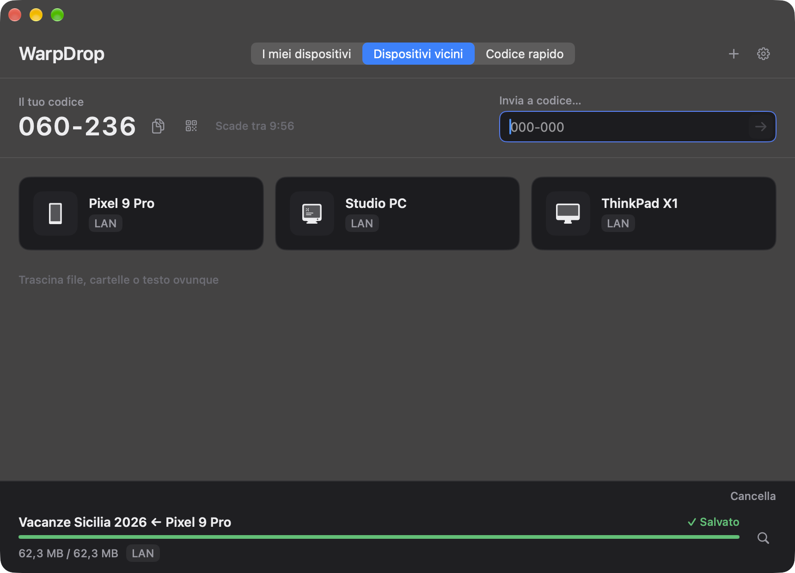
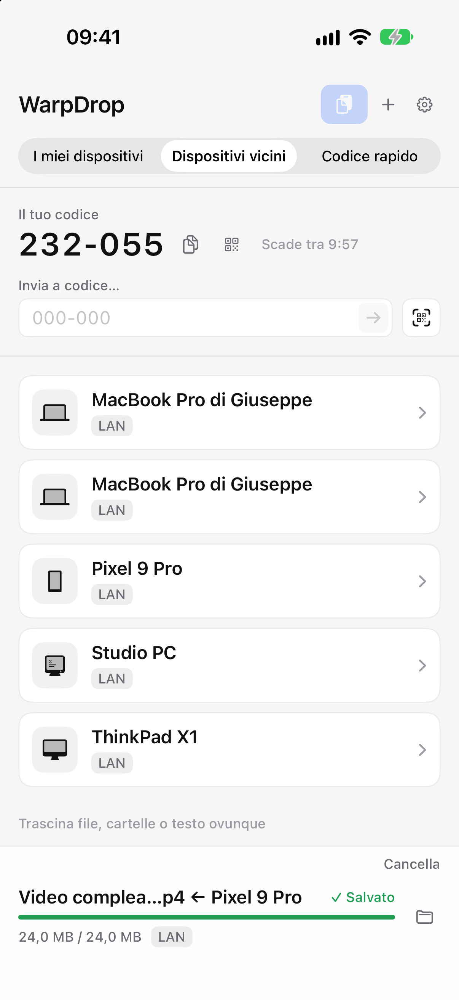
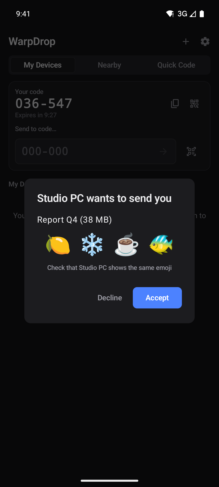
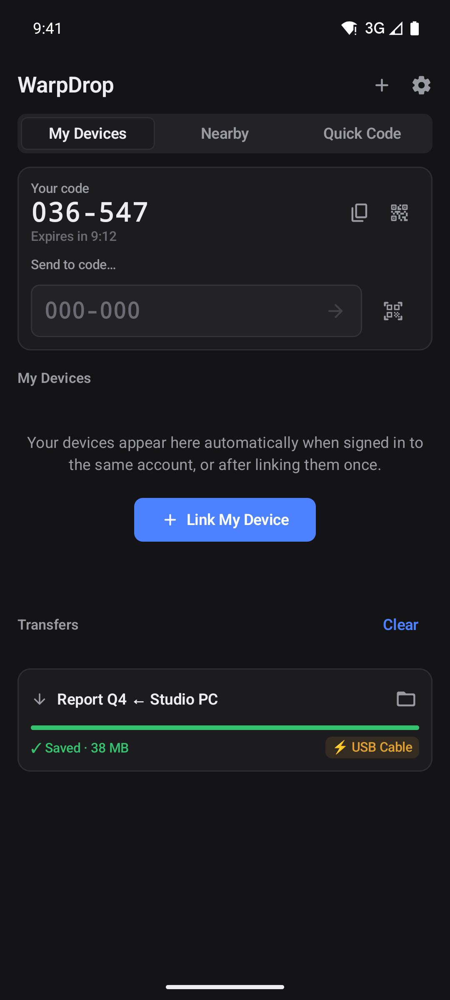
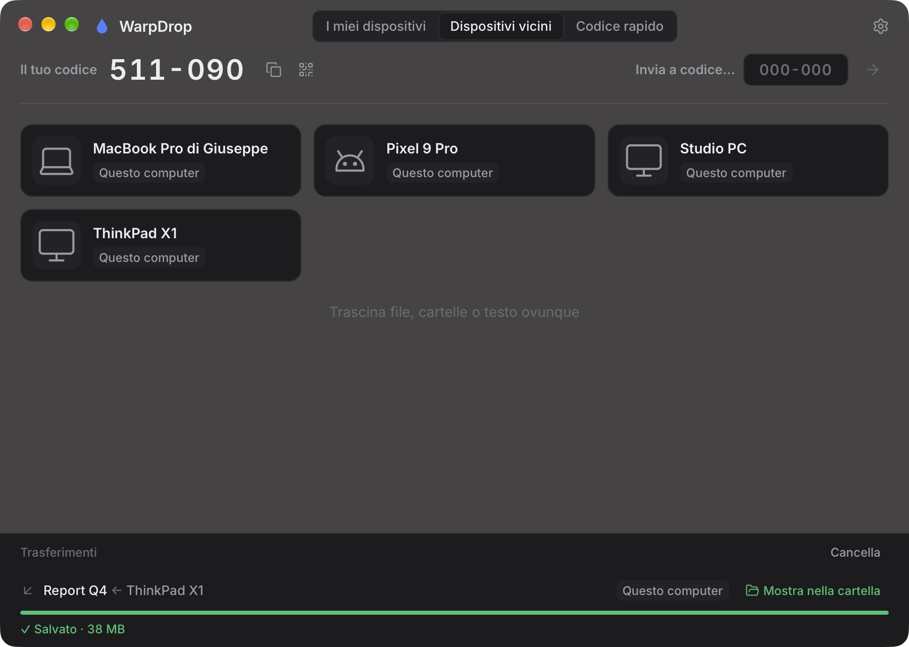

<p align="center">
  <a href="README.md">English</a> · <b>Italiano</b>
</p>

<h1 align="center">WarpDrop</h1>

<p align="center">
  Trasferimento di file, cartelle e appunti con crittografia end-to-end tra<br>
  <b>macOS · iOS · Android · Windows · Linux</b><br>
  via cavo USB, rete locale o Internet.
</p>

<p align="center">
  
</p>

<p align="center">
  
  &nbsp;
  
  &nbsp;
  
</p>

<p align="center">
  
</p>

## Perché WarpDrop

- **Meglio di AirDrop, su ogni sistema.** I tuoi dispositivi compaiono in *I miei dispositivi* e ricevono con un clic, senza conferme. Per tutti gli altri basta un **codice a 6 cifre** (`482-910`) o un QR code: niente account, niente registrazioni.
- **Sempre la strada più veloce.** Prima il cavo USB o Thunderbolt (⚡), poi Wi-Fi Direct/AWDL, Ethernet e Wi-Fi, infine Internet (P2P diretto o relay cifrato end-to-end).
- **Cartelle senza zip.** I file viaggiano in streaming, compressi solo quando serve e verificati con BLAKE3 blocco per blocco.
- **Riprende da solo.** Stacchi il cavo al 94 %? WarpDrop si riconnette su qualsiasi percorso disponibile, anche via Internet, e invia solo la parte mancante. Nessun nuovo codice, nessuna conferma.
- **Appunti universali.** `⌘V` / `Ctrl+V` nella finestra invia testo, link e immagini agli appunti dell'altro dispositivo.
- **Italiano e inglese** ovunque: segue la lingua di sistema, con la possibilità di cambiarla nell'app.

## Download

Ultima versione: **[Release → latest](../../releases/latest)**

| Piattaforma | File | Note |
|---|---|---|
| macOS 14+ (Apple silicon e Intel) | `WarpDrop-<versione>-macOS.dmg` | Finestra + goccia nella barra dei menu (trascina i file sull'icona). Firmato con Developer ID e notarizzato da Apple. |
| Windows 10/11 (x64) | `WarpDrop_<versione>_x64-setup.exe` oppure `WarpDrop_<versione>_x64_it-IT.msi` / `_en-US.msi` | Installa WebView2 se necessario. |
| Linux (x86_64) | `WarpDrop_<versione>_amd64.deb` oppure `WarpDrop_<versione>_amd64.AppImage` | Rendi eseguibile l'AppImage con `chmod +x`. |
| Android 11+ | `WarpDrop-<versione>-android*.apk` | Consenti l'installazione dal browser o dall'app File. |
| iOS / iPadOS 17+ | compilazione da sorgente (Xcode) | La distribuzione via App Store / TestFlight richiede un account Apple Developer. |
| Server di rendezvous | `warp-signal-linux-x86_64.tar.gz` | Facoltativo: serve per usare i codici tra reti diverse (include anche la CLI `warp`). |

Ogni release include `SHA256SUMS.txt`.

## Come si usa

1. Apri WarpDrop su entrambi i dispositivi.
2. **Dispositivo vicino o tuo?** Trascina i file sulla sua scheda (oppure cliccala per sceglierli).
3. **Chiunque altro:** detta il tuo codice (`Il tuo codice: 849-201`) oppure scrivi il suo in *Invia a codice…*. Funziona anche la scansione del QR code.
4. **Rendere un dispositivo "tuo" per sempre:** *Collega un mio dispositivo* → *Mostra il mio codice* su uno, *Inserisci codice* sull'altro. Da lì in poi basta un clic, senza conferme. I dispositivi Apple con lo stesso account iCloud si collegano da soli.
5. **Tra reti diverse:** avvia `warp-signal` su un server raggiungibile (vedi sotto) e imposta il suo URL in *Impostazioni → Server relay Internet* su ogni dispositivo.

## Sicurezza

- Ogni dispositivo ha un'identità **Ed25519**. Tutte le connessioni usano **QUIC + TLS 1.3** (AES-256-GCM / ChaCha20-Poly1305).
- *I miei dispositivi* usano chiavi fissate e TLS mutuo.
- I **codici a 6 cifre** sono autenticati con **SPAKE2**, legato alla sessione TLS. Un attaccante in mezzo ha un solo tentativo su un milione, e il codice cambia dopo 3 tentativi errati e dopo ogni uso.
- I dispositivi vicini sconosciuti vanno **accettati**, e i due schermi mostrano le stesse **4 emoji** da confrontare.
- Il relay non possiede mai le chiavi: vede solo un hash "memory-hard" del codice e pacchetti QUIC cifrati.
- I **ticket di ripresa** (256 bit, 30 minuti) sono legati alla chiave del mittente e all'esatto elenco di file: un ticket rubato non serve a nulla.
- Ogni byte è verificato con **BLAKE3**. I file compaiono nella cartella di download solo quando l'hash corrisponde. I percorsi ostili (`../`, nomi riservati) vengono rifiutati.

Architettura, protocollo e risultati dei test (in inglese): [docs/ARCHITECTURE.md](docs/ARCHITECTURE.md).

## Compilare dal sorgente

Requisiti: Rust (stable) più la toolchain di ogni piattaforma da compilare.

```sh
cargo test --workspace                           # test del motore (clippy: cargo clippy --workspace --all-targets)
cargo build --release -p warp-cli -p warp-signal # CLI + server di rendezvous
```

| Target | Comandi |
|---|---|
| **macOS / iOS** (Xcode 16+, `brew install xcodegen`) | `./scripts/build-apple.sh`, poi apri `apple/WarpDrop.xcodeproj` (schemi `WarpDrop-macOS`, `WarpDrop-iOS`) |
| **Android** (SDK 37, JDK 17+, `cargo install cargo-ndk`) | `./scripts/build-android.sh && (cd android && ./gradlew :app:assembleDebug)` |
| **Windows / Linux** (Node 22, prerequisiti Tauri) | `cd desktop && npm ci && npm run tauri build` |
| **Dispositivi reali** | `./scripts/dev-launch.sh` avvia un `warp-signal` locale e l'app macOS, poi stampa i comandi di installazione per gli iPhone (`xcrun devicectl`) e gli Android (`adb`) collegati |

Pacchetti Linux per l'app desktop: `libwebkit2gtk-4.1-dev libgtk-3-dev libayatana-appindicator3-dev librsvg2-dev libxdo-dev libssl-dev`.

### Riga di comando

```sh
warp receive                          # mostra "Your code: 482-910"
warp send 482-910 ~/Pictures/Viaggio  # da un altro computer sulla stessa rete
warp clip 482-910 "ciao"              # invio agli appunti
warp peers | ifaces | hash FILE
```

### Server di rendezvous / relay

```sh
docker build -f rendezvous-relay/Dockerfile -t warp-signal .
docker run -p 47900:47900/tcp -p 47900:47900/udp warp-signal
```
Poi usa `ws://<host>:47900` (oppure `wss://` dietro un proxy TLS) come URL del relay.

## Struttura del repository

```
core-rust/libwarp     motore Rust: discovery, QUIC/TLS 1.3, SPAKE2, streaming, ripresa (binding UniFFI)
core-rust/warp-cli    nodo da riga di comando `warp`
rendezvous-relay      `warp-signal`: rendezvous + relay UDP
apple/                Swift 6 / SwiftUI: macOS, iOS, estensioni Condividi, Live Activity
android/              Kotlin / Jetpack Compose
desktop/              Tauri v2 (Rust + React/TypeScript): Windows, Linux
docs/                 design system, screenshot;   i18n/strings.json: testi IT/EN condivisi
```

## Pubblicare una release

Un tag `vX.Y.Z` avvia [`.github/workflows/release.yml`](.github/workflows/release.yml):
1. test del motore;
2. build in parallelo di Windows, Linux, macOS, Android e del server;
3. release GitHub in bozza, con i checksum.

La firma è facoltativa e si attiva con i secret del repository: `MACOS_*`/`APPLE_*` (Developer ID + notarizzazione), `WINDOWS_CERTIFICATE*`, `ANDROID_KEYSTORE*`. I dettagli sono nei commenti in cima al workflow. I secret Android sono impostati, quindi la CI pubblica un APK firmato per il rilascio.

La build macOS firmata e notarizzata si crea su un Mac con l'Apple ID collegato a Xcode: `./scripts/release-macos.sh 1.2.0 --upload v1.2.0` la compila e sostituisce nella release il `.dmg` non firmato della CI.

## Limitazioni note

- iOS non è distribuito come binario: serve un account Apple Developer.
- Senza i secret di firma, macOS e Windows mostrano un avviso al primo avvio, e per Android viene pubblicato un APK firmato in debug.
- Il collegamento automatico via iCloud e il portachiavi condiviso richiedono una build Apple firmata (la release macOS pubblicata lo è; le build locali non firmate ne fanno a meno).
- Rimuovere un dispositivo da *I miei dispositivi* ha effetto solo su quel dispositivo.

## Licenza

[MIT](LICENSE) © 2026 Giuseppe Gambino
