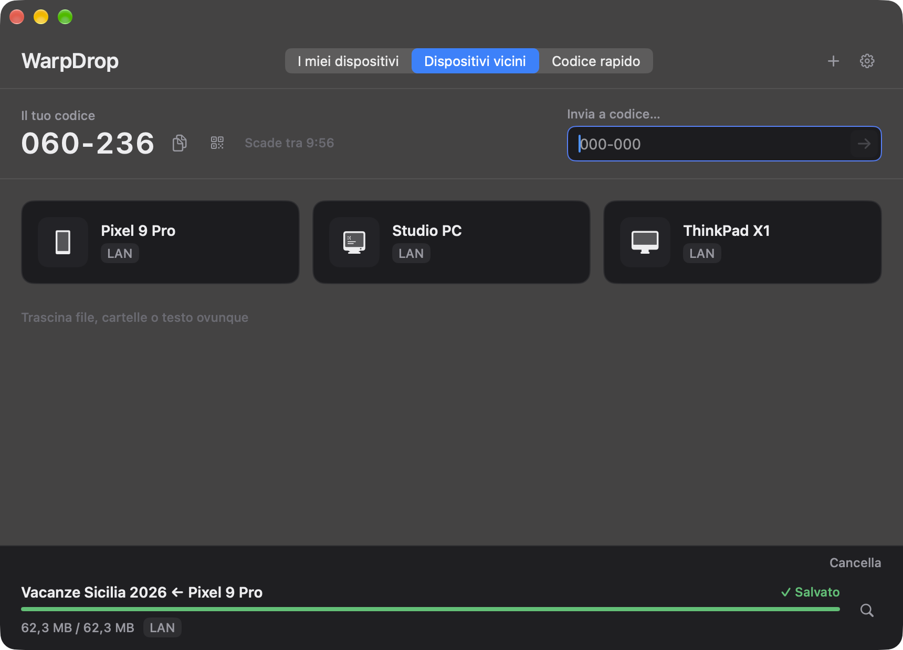
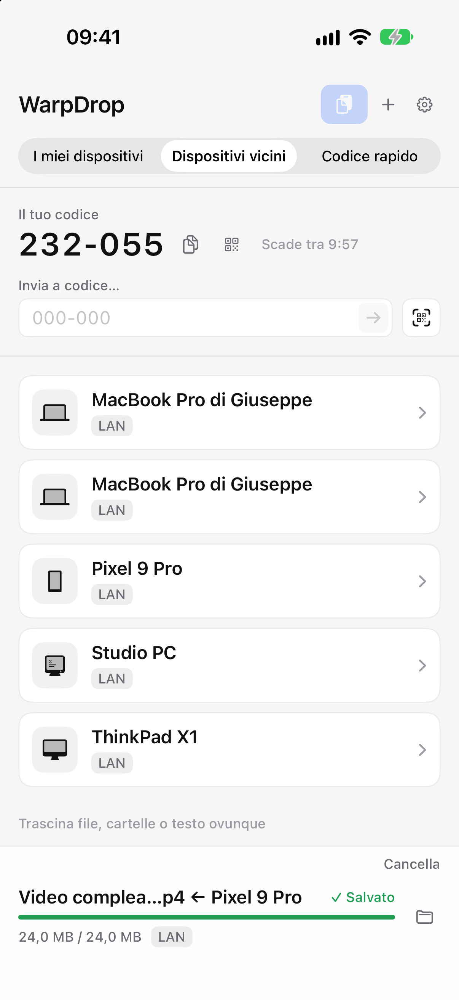
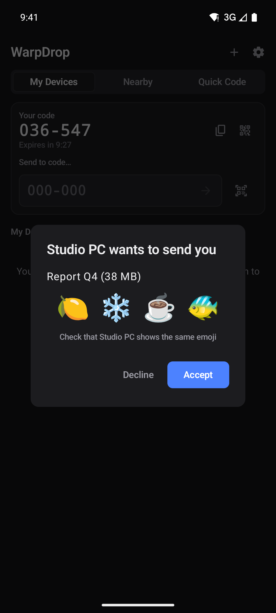
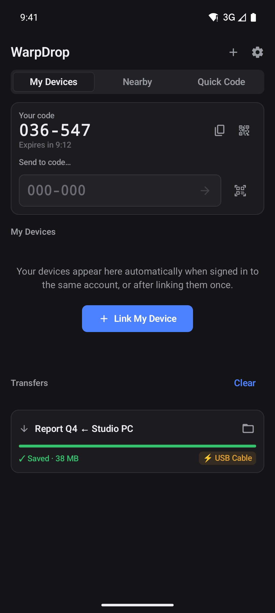
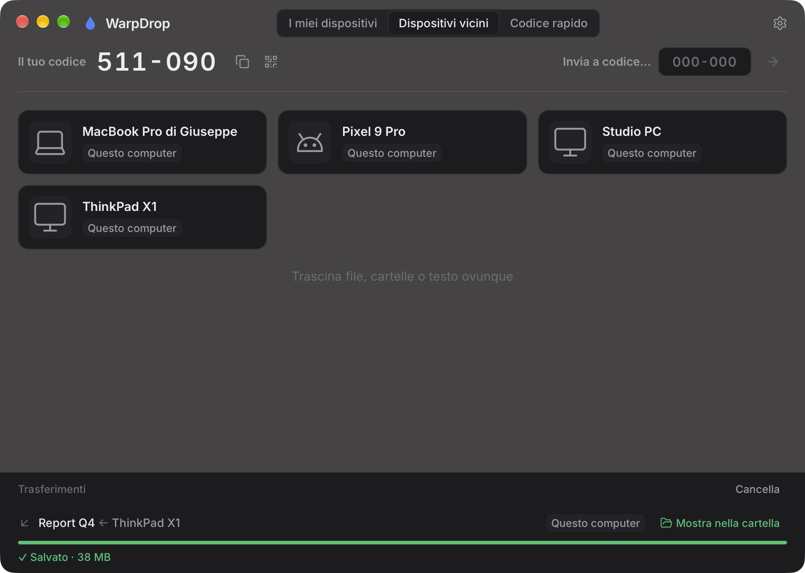

<p align="center">
  <b>English</b> · <a href="README.it.md">Italiano</a>
</p>

<h1 align="center">WarpDrop</h1>

<p align="center">
  <b>Like AirDrop, but between any of your devices: Mac, iPhone, Android, Windows and Linux.</b>
</p>

<p align="center">
  <a href="https://github.com/giuseppegambino92/WarpDrop/releases/latest"></a>
  <a href="https://github.com/giuseppegambino92/WarpDrop/actions/workflows/release.yml"></a>
  <a href="LICENSE"></a>
</p>

WarpDrop sends files, whole folders and the clipboard from one device to another. Your own devices
receive with one click; with anyone else you share a 6-digit code or a QR code, with no accounts and no
sign-up. It picks the fastest path on its own (USB cable, local network, or the Internet through a relay server you can host yourself), encrypts
everything end to end, and resumes an interrupted transfer where it stopped.

<p align="center">
  
</p>

## Download

Latest release: **[WarpDrop 1.0.1](https://github.com/giuseppegambino92/WarpDrop/releases/latest)** (newer versions, when published, are always on that page).

| Platform | Download | Notes |
|---|---|---|
| macOS 14+ (Apple silicon & Intel) | [WarpDrop-1.0.1-macOS.dmg](https://github.com/giuseppegambino92/WarpDrop/releases/download/v1.0.1/WarpDrop-1.0.1-macOS.dmg) | Window + menu-bar droplet (drag files onto the icon). Signed with Developer ID and notarized by Apple. |
| Windows 10/11 (x64) | [Installer (.exe)](https://github.com/giuseppegambino92/WarpDrop/releases/download/v1.0.1/WarpDrop_1.0.1_x64-setup.exe) · [MSI English](https://github.com/giuseppegambino92/WarpDrop/releases/download/v1.0.1/WarpDrop_1.0.1_x64_en-US.msi) · [MSI Italiano](https://github.com/giuseppegambino92/WarpDrop/releases/download/v1.0.1/WarpDrop_1.0.1_x64_it-IT.msi) | Installs WebView2 if needed. |
| Linux (x86_64) | [.deb](https://github.com/giuseppegambino92/WarpDrop/releases/download/v1.0.1/WarpDrop_1.0.1_amd64.deb) · [.AppImage](https://github.com/giuseppegambino92/WarpDrop/releases/download/v1.0.1/WarpDrop_1.0.1_amd64.AppImage) | `chmod +x` the AppImage. |
| Android 11+ | [WarpDrop-1.0.1-android.apk](https://github.com/giuseppegambino92/WarpDrop/releases/download/v1.0.1/WarpDrop-1.0.1-android.apk) | Allow installs from your browser/files app. |
| iOS / iPadOS 17+ | [build from source](#build-from-source) (Xcode) | App Store / TestFlight distribution needs an Apple Developer account. |
| Rendezvous server | [warp-signal-linux-x86_64.tar.gz](https://github.com/giuseppegambino92/WarpDrop/releases/download/v1.0.1/warp-signal-linux-x86_64.tar.gz) | Optional, for codes across different networks (also includes the `warp` CLI). |

Every release includes [`SHA256SUMS.txt`](https://github.com/giuseppegambino92/WarpDrop/releases/download/v1.0.1/SHA256SUMS.txt).

<p align="center">
  
  &nbsp;
  
  &nbsp;
  
</p>

<p align="center">
  
</p>

## Why WarpDrop

- **AirDrop-style sharing on every OS.** Your own devices appear under *My Devices* and receive with one click, no prompts. Anyone else gets a **6-digit code** (`482-910`) or a QR code: no accounts, no sign-up.
- **Always the fastest path.** USB cable or Thunderbolt first (⚡), then Wi-Fi Direct/AWDL, Ethernet, Wi-Fi, and finally the Internet (direct P2P, or an end-to-end encrypted relay).
- **Folders without zipping.** Files stream on the fly, compressed only when it helps, verified with BLAKE3 chunk by chunk.
- **Resumes on its own.** Pull the cable at 94 %: WarpDrop reconnects over any available path, including the Internet, and sends only the missing part, with no new code and no prompt.
- **Universal clipboard.** `⌘V` / `Ctrl+V` in the window pushes text, links and images to the other device's clipboard.
- **English and Italian** everywhere, following the system language with an in-app override.

## How to use it

1. Open WarpDrop on both devices.
2. **Nearby or yours?** Drop files on the device card (or click it to pick files).
3. **Anyone else:** read them your code (`Your code: 849-201`), or type theirs in *Send to code…*. Scanning the QR code works too.
4. **Make a device permanently yours:** *Link My Device* → *Show my code* on one device, *Enter code* on the other. From then on it is one click, no prompts. Apple devices on the same iCloud account are linked automatically.
5. **Across networks:** run `warp-signal` somewhere reachable (see below) and set its URL in *Settings → Internet relay server* on every device.

## Security

- Every device has an **Ed25519** identity. All connections are **QUIC + TLS 1.3** (AES-256-GCM / ChaCha20-Poly1305).
- **My Devices** use pinned keys and mutual TLS.
- **6-digit codes** are authenticated with **SPAKE2**, bound to the TLS session. A man-in-the-middle gets one guess in a million, and the code rotates after 3 wrong attempts and after every use.
- Unknown nearby devices must be **accepted**, and both screens show the same **4 emoji** to compare.
- The relay never holds keys. It sees a memory-hard hash of the code and encrypted QUIC packets.
- **Resumption tickets** (256-bit, 30 min) are bound to the sender's key and to the exact file list, so a stolen ticket is useless.
- Every byte is verified with **BLAKE3**. Files appear in the download folder only after their hash matches. Hostile paths (`../`, reserved names) are rejected.

Architecture, protocol and test results: [docs/ARCHITECTURE.md](docs/ARCHITECTURE.md).

## Build from source

Requirements: Rust (stable), plus the toolchain of each platform you build.

```sh
cargo test --workspace                           # engine tests (clippy: cargo clippy --workspace --all-targets)
cargo build --release -p warp-cli -p warp-signal # CLI + rendezvous server
```

| Target | Commands |
|---|---|
| **macOS / iOS** (Xcode 16+, `brew install xcodegen`) | `./scripts/build-apple.sh`, then open `apple/WarpDrop.xcodeproj` (schemes `WarpDrop-macOS`, `WarpDrop-iOS`) |
| **Android** (SDK 37, JDK 17+, `cargo install cargo-ndk`) | `./scripts/build-android.sh && (cd android && ./gradlew :app:assembleDebug)` |
| **Windows / Linux** (Node 22, Tauri prerequisites) | `cd desktop && npm ci && npm run tauri build` |
| **Live devices** | `./scripts/dev-launch.sh` starts a local `warp-signal`, launches the macOS app and prints install commands for connected iPhones (`xcrun devicectl`) and Android phones (`adb`) |

Linux packages for the desktop app: `libwebkit2gtk-4.1-dev libgtk-3-dev libayatana-appindicator3-dev librsvg2-dev libxdo-dev libssl-dev`.

### Command line

```sh
warp receive                          # shows "Your code: 482-910"
warp send 482-910 ~/Pictures/Trip     # from another machine on the LAN
warp clip 482-910 "hello"             # clipboard push
warp peers | ifaces | hash FILE
```

### Rendezvous / relay server

```sh
docker build -f rendezvous-relay/Dockerfile -t warp-signal .
docker run -p 47900:47900/tcp -p 47900:47900/udp warp-signal
```
Then use `ws://<host>:47900` (or `wss://` behind a TLS proxy) as the relay URL.

Optional environment variables: `WARP_SIGNAL_TRUST_PROXY=1` behind a reverse proxy (per-IP limits use `X-Forwarded-For`), `WARP_SIGNAL_MAX_SESSIONS`, `WARP_SIGNAL_MAX_CONNS_PER_IP`, `WARP_SIGNAL_MAX_SESSION_GB`. `WARP_SIGNAL_LEGACY_BIND=1` serves v1.0.0 apps over the relay as well (their UDP binding is not authenticated, so turn it off once they are updated).

## Repository layout

```
core-rust/libwarp     Rust engine: discovery, QUIC/TLS 1.3, SPAKE2, streaming, resume (UniFFI bindings)
core-rust/warp-cli    `warp` command-line node
rendezvous-relay      `warp-signal` rendezvous + UDP relay
apple/                Swift 6 / SwiftUI: macOS, iOS, Share extensions, Live Activity
android/              Kotlin / Jetpack Compose
desktop/              Tauri v2 (Rust + React/TypeScript): Windows, Linux
docs/                 architecture, design system, screenshots;   i18n/strings.json: shared EN/IT strings
```

## Releasing

Pushing a tag `vX.Y.Z` runs [`.github/workflows/release.yml`](.github/workflows/release.yml):
1. engine tests;
2. Windows, Linux, macOS, Android and server builds in parallel;
3. a draft GitHub Release with checksums.

Signing is optional and enabled through repository secrets: `MACOS_*`/`APPLE_*` (Developer ID + notarization), `WINDOWS_CERTIFICATE*`, `ANDROID_KEYSTORE*`. See the comments at the top of the workflow. The Android secrets are set, so CI publishes a release-signed APK.

The signed, notarized macOS build is made on a Mac with the Apple ID signed into Xcode: `./scripts/release-macos.sh 1.2.0 --upload v1.2.0` builds it and replaces the CI's unsigned `.dmg` in that release.

## Known limitations

- iOS is not distributed as a binary (needs an Apple Developer account).
- Without signing secrets, macOS/Windows show a first-launch warning and Android ships a debug-signed APK.
- iCloud auto-linking and the shared Keychain need a signed Apple build (the published macOS release is signed; local unsigned builds skip them).
- Removing a device from *My Devices* is local to that device.

## License

[MIT](LICENSE) © 2026 Giuseppe Gambino
